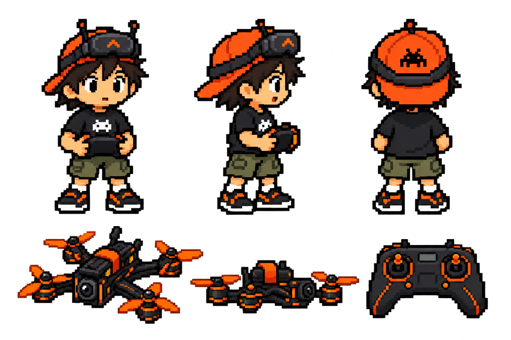
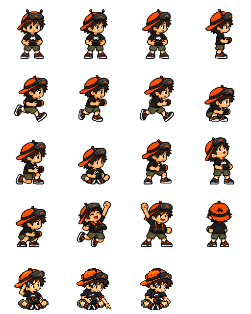

# OpenBando pixel mascot — character bible v2

The two original sheets in [the working plan](../archive/working-plan/mascotte-img/) are the starting references. The final generation uses the **coarse 16-bit pixel direction**, not the discarded smooth chibi passes. The latest brief explicitly requires an ergonomic mostly black radio, orange rather than red, a full circumferential goggle strap and a black cap emblem.

## Identity that must stay fixed

- Small cheerful FPV pilot, oversized head, dark messy hair, orange backwards cap. Keep head/body ratio consistent across additions; do not switch between a realistic adolescent and a round toy.
- Warm orange cap and equipment accents, charcoal/black equipment, olive cargo shorts, white socks and black trainers with white soles. No red replacement accents. The previous orange read too red; target a clear saturated orange (reference #ff7900), with darker orange shadows rather than red/brown. Palette approval remains a visual review item.
- **Black** pixel alien emblem on the cap; **white** alien emblem on the black shirt. They are deliberately different colours. No text/brands on cap, goggles, radio or drone.
- Goggles rest on the forehead. Dark elastic strap attaches at both side mounts and goes **360° around the head**, visibly continuing across the temples and back of the cap/head. It is not a crown strap or a floating side strip. Keep its path consistent in profile and back poses.
- Radio is a compact two-handed **ergonomic gamepad transmitter**: mostly black, concave sides, sculpted downward palm grips, restrained orange seams. Never substitute a rectangular box. **No radio antennas.**
- Radio control surface always faces the pilot, tipped up toward the torso. A front spectator sees the back shell, not sticks and gimbal rings. In a profile pose, show the narrow tilted edge and grip volume. Both hands cradle the grips; the neck strap supports it during a one-handed victory.
- Freestyle 5-inch **open X-frame** quadcopter: four exposed motors, orange three-blade props, black carbon arms, top battery and orange strap, small front camera. No ducts, prop guards, folding arms or camera-drone silhouette. Equipment proportions must be stable between flight states.

## Pixel art rules

- Coarse, deliberate square pixel clusters, stepped contours, dark outline, limited flat shading, retro 16-bit sprite feel. Inspect at normal display size and at nearest-neighbour enlargement.
- Do not accept smooth anime/chibi painting with a pixel filter added later. Avoid glossy shading, soft shadows, halos and invented fine details. The smooth trial sheets were rejected.
- Production PNGs are 128×128 transparent canvases; they are displayed with `image-rendering: pixelated`. Their generated master contains more colours than a strict hardware palette: “16-bit” describes the visual direction, not a claim of a palette-verified console asset.
- Preserve alpha. Never bake a checkerboard, dark background or orange glow into transparent margins. No repeated resizing with bilinear interpolation. Source art is immutable; export uses nearest-neighbour resampling.

## Asset inventory

| Path | Purpose |
|---|---|
| `pilot-source.png` | Imagegen master with all 16 poses, unchanged |
| `poke-source.png` | Imagegen master for the grounded-drone poke |
| `confused-source.png` | Separate imagegen export source for cross-legged confusion, hand to head and manga sweat drop |
| `drone-right-source.png` | Right-facing quad used for the exit |
| `drone-source.png` | Separate imagegen quad master, unchanged |
| `turnaround.png` | Front/profile/back plus drone/radio design reference |
| `../../public/mascot/poses/*.png` | Individual numbered 128×128 pose keyframes |
| `../../public/mascot/keyframes.png` | Packed 4×5 keyframe preview (19 poses) |
| `../../public/mascot/poster.png` | Still fallback / reduced-motion art |
| `../../public/mascot/drone.png` | Drone runtime sprite |
| `../../public/mascot/drone-right.png` | Right-facing exit sprite |
| `../../public/mascot/timeline.json` | Authoritative 19.7-second choreography |
| `../../public/mascot/openbando-mascot.gif` | Portable 10 fps animated preview |

## Keyframes

Indices are zero-based. Names are stable API, not descriptions of an automatically verified drawing.

| Index | Name | Use / rule |
|---|---|---|
| 0 | idle | Front ready stance, hands on radio |
| 1 | look-quarter-a | Quarter view; mirrored in playback for left look |
| 2 | look-quarter-b | Other quarter look to the right |
| 3 | side | Right profile; radio tilted toward torso |
| 4–6 | run-a / run-pass / run-b | Right-running pose cycle, fixed pilot position |
| 7 | crouch | Low squat, both hands keep radio |
| 8 | low | One knee down |
| 9 | sit | Legs folded, radio in lap facing pilot |
| 10 | rise | Intermediate pose returning to standing |
| 11 | look-up | Tracks takeoff |
| 12 | anticipate | Knee bend before jump |
| 13 | jump | Airborne celebration, strap supports radio |
| 14 | victory | Landed celebration |
| 15 | back | Full rear equipment/strap reference, reserved for future turns |
| 16 | confused-a | Cross-legged, hand scratching head, manga sweat drop; held keyframe |
| 17 | poke | Seated, arm reaches downward to the grounded quad; used twice before takeoff |
| 18 | poke-middle | Hand retracts to the knee between the two pokes |

The generated source is **not an exact regular atlas**: the jump fist crosses a nominal row boundary. `RECTS` in `tools/mascot/build.py` records reviewed sprite bounds, preventing stray shoes or a cropped fist. Every export uses one common scale and foot baseline; never scale each cropped pose to fill the square independently.

## Choreography

0–2.4 s the pilot searches while the drone is hidden; 2.4–4.8 s he runs as the grounded drone arrives; 4.8–9 s he crouches, sits and looks perplexed; 9–10.2 s he pokes twice with a hand-retraction frame between; he sits as the drone takes off, then rises, looks up, jumps and celebrates. The drone flies right and the loop returns to idle. Both canvas and GIF use the same timeline and propeller highlights.

The canvas and GIF read the same JSON timeline. README uses the GIF below the pixel-art OPENBANDO wordmark; Welcome uses the same wordmark with accessible alternative text; it links to a still alternative because GitHub does not offer a playback control for inline GIFs. The GIF is a portable preview; Welcome uses canvas for the same animation. It is decorative and hidden from assistive technology. Only Welcome animates; no mascot overlays the simulator, editing controls or flight instruments. Hidden/minimized Welcome and background tabs stop progress. Reduced-motion preference shows a still image. The Welcome pause control was removed at the project owner’s request. The exit uses a separate right-facing sprite; flight uses alternating propeller highlights. Browser visual review remains pending.

## Adding poses or actions

1. Start from the current turnaround plus master, not the rejected smooth sheets. Keep the equipment orientation rules above verbatim in any generation brief.
2. Export the new pose as a versioned addition before replacing any approved frame. Show front/profile/back equipment continuity and the drone with it when changing the design.
3. Review hands, radio grips/angle, full strap, cap emblem, four drone motors and the exposed prop silhouette. Reject identity drift, a single radio antenna, missing limbs, smooth illustration or new logos.
4. Add its reviewed source bounds and stable name to the exporter and `MASCOT_POSES`; append indices rather than renumber existing ones. Add a timeline phase only if the new motion has a purpose. Keep the pilot's planted feet on the common baseline; move jump height in the timeline.
5. Run `python tools/mascot/build.py` (Python 3 + Pillow) from repository root. Commit both source and derived assets. This script packages existing generated art and composites frames; it does not invent new poses.
6. Check the full GIF loop, every cell edge, the paused/reduced-motion poster, a narrow Welcome panel and the asset paths beneath `/openbando/`. Run unit, type, translation and production-build checks. A passing timeline test does not establish anatomical or visual correctness.

## Generation brief / provenance

Built-in imagegen was used with the repository's Pixel FPV Pilot Animation Sheet as the identity reference. Final briefs required a coarse 16-bit treatment; orange backwards cap with black alien emblem; white shirt emblem; 360° dark goggle strap; mostly black ergonomic radio with orange trim and no antennas, control surface facing the torso; open-frame 5-inch black/orange quad. The original pose brief enumerated sixteen pilot keyframes; confusion, poke and poke-middle extend the current table to nineteen and required transparent padding with no labels/shadows. The drone brief extracted the turnaround quad as a separate pixel sprite and explicitly removed glow/halos. Future generations must carry all these invariants, not only the word “pixel”.

Sources live in this directory; production assets live under `public/mascot/`. No proprietary character identity is intended; the originals and generated character belong to this project's art direction.

Showcase playback holds the final frame after one 19.7-second loop until the panel closes. Card films are fitted into its thirds so the search/run/sit sequence cannot begin again while cards finish. The source timeline, ordinary Welcome loop and GIF remain unchanged; this removes an unintended partial second loop rather than deleting approved poses. Tour Pause freezes rendered mascot progress.
